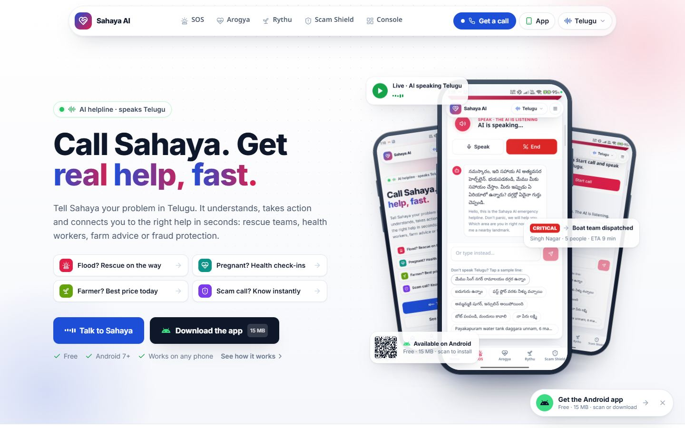
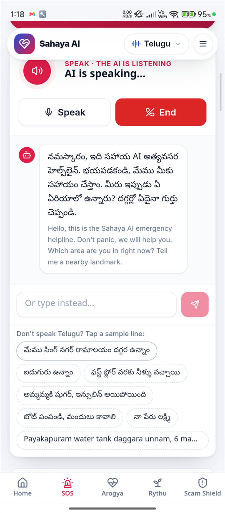
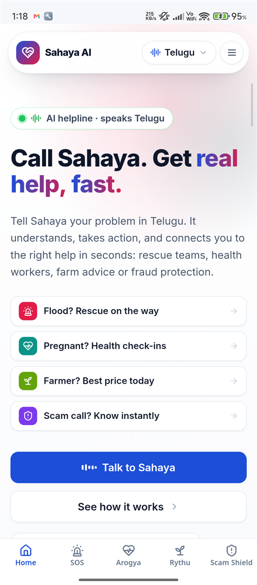
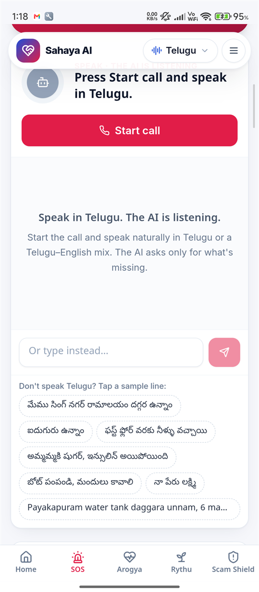
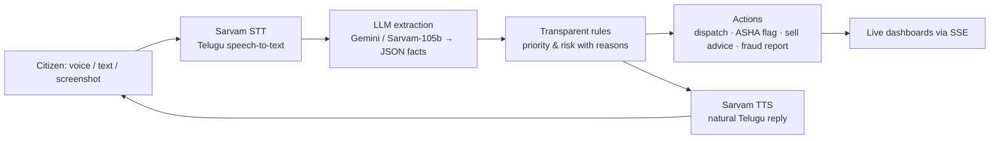

# Sahaya AI — the AI helpline that speaks Telugu

**Live demo:** https://sahaya.hmgenx.in  ·  **Android app:** https://sahaya.hmgenx.in/download/Sahaya-AI.apk

> Call Sahaya. Get real help, fast. Tell Sahaya your problem in Telugu — it understands, takes action, and connects you to the right help in seconds: rescue teams, health workers, farm advice or fraud protection.



<p align="center">
  
  
  
  <br><sub>Real screenshots from the Sahaya Android app — the AI speaking Telugu on a live call</sub>
</p>

Built for **PromptWars × Creative Community VVITU** (Hack2Skill × Google for Developers) — challenge: *AI for Better Living & Smarter Communities*.

---

## The problem

Millions of people in Andhra Pradesh and Telangana are most comfortable speaking Telugu, many use basic phones, and many cannot read English forms or apps. Yet the moments that matter most — a flood at the door, a risky pregnancy, a crop price crash, a "digital arrest" scam call — still depend on English apps, long forms or overloaded helplines.

## The solution: one voice‑AI engine, four lifelines

| Lifeline | Who it helps | What Sahaya does |
|---|---|---|
| **Disaster SOS** (`/sos`, `/console/sos`) | People stuck in floods/cyclones, district control rooms | Takes a Telugu voice or text SOS, extracts location, people, water level, vulnerable people and medical needs, ranks priority with transparent rules, auto‑dispatches the nearest rescue team for critical cases and shows everything live on a control‑room map with an AI situation report and resource forecast. |
| **Arogya Call** (`/arogya`, `/console/arogya`) | Pregnant women, BP/diabetes and TB patients, ASHA workers | AI follow‑up calls ask programme‑specific questions in Telugu, flag danger signs (bleeding, chest pain, blood in cough…) with explainable reasons, and put high‑risk patients at the top of the ASHA dashboard. Includes a one‑click call campaign. |
| **Rythu Call** (`/rythu`, `/console/rythu`) | Farmers, agriculture officers | Answers "where should I sell my tomatoes?" or "will it rain in Guntur?" by voice — live 7‑day weather (Open‑Meteo), mandi price trends with a 3‑day forecast and net‑gain sell advice, plus district alert broadcasts. |
| **Scam Shield** (`/scam`, `/console/scam`) | Elders and families, cyber‑cell awareness teams | Checks a suspicious SMS/WhatsApp message, screenshot or described call. 20+ rules plus AI analysis give a verdict, red flags and what to do, spoken in Telugu, with one‑tap 1930 / cybercrime.gov.in / family‑alert actions. |
| **Real phone calls** (`/console/phone`) | Anyone with a basic phone | The same agents can place real outbound calls through Sarvam Samvaad or Plivo (whitelisted numbers, rate‑limited). |

The website UI is in English; **the AI speaks Telugu today**, with Hindi, Tamil, Kannada, Malayalam, Marathi, Bengali, Gujarati, Punjabi, Odia and English voices on the roadmap (the engine already supports them).

## How it works



* **The AI understands, the rules decide.** The language model only extracts facts from free‑form speech; priority and risk come from simple, auditable rules, so every decision has a human‑readable reason.
* **Every fixed line is pre‑rendered** and cached on disk, so replies play instantly and the voice API is never hammered.
* **Human in the loop.** Only life‑threatening SOS cases are auto‑dispatched; everything else waits for an operator.

## Tech stack

* **Frontend:** React 18 + TypeScript + Vite, Tailwind CSS, Framer Motion, React Router, Leaflet + OpenStreetMap, Recharts — an installable **PWA** (always‑light theme, lazy‑loaded modules).
* **Backend:** Node.js 22 + Fastify 5, Server‑Sent Events for live updates, JSON stores, rate limiting and a Sarvam concurrency gate with retries.
* **AI:** Sarvam AI (saarika STT, bulbul TTS, sarvam‑105b LLM, translation) with Google Gemini support (reasoning and screenshot vision); Sarvam Samvaad / Plivo for real phone calls.
* **Android:** Flutter WebView app with microphone permission, splash animation and offline screen.
* **Hosting:** Hostinger VPS (Mumbai) + nginx + Let's Encrypt, systemd service, one‑command deploy script.

## Project structure

```
server/            Fastify API — index.mjs, lib/ (ai, voice, flow engine, i18n, store, sse, sessions)
  modules/         sos.mjs · arogya.mjs · rythu.mjs · scam.mjs · phone.mjs (auto-loaded)
web/               React + Vite PWA — src/components (VoiceCall, Layout, Preloader…), src/modules/<id>
android/           Flutter app wrapper (android/app)
deploy/            deploy.ps1, nginx + systemd templates
scripts/smoke.mjs  End-to-end smoke test of all modules
```

## Run locally

```bash
# 1. API keys (never commit this file)
cat > .env <<'EOF'
SARVAM_API_KEY=your_sarvam_key
VOICE_SPEAKER=kavitha
# optional: GEMINI_API_KEY=...
EOF

# 2. Install and build
cd server && npm install && cd ..
cd web && npm install && npx vite build && cd ..

# 3. Start (serves the API and the built web app)
node server/index.mjs        # http://127.0.0.1:4200

# 4. Smoke test every module
node scripts/smoke.mjs http://127.0.0.1:4200
```

## Responsible AI

* Priority and risk come from explainable rules, never from a black box.
* Scam checks store only anonymised type/verdict counts — never the message or screenshot.
* Health answers never diagnose or prescribe; danger signs always route to the ASHA worker, PHC or 108.
* All seeded incidents, patients and mandi prices are clearly labelled **demo data**.
* Real phone calls are limited to approved numbers, rate‑limited and capped per day.

## Built with AI

The whole platform — five modules, the voice engine, the PWA, the Android app and the deployment — was built during the event with **Claude Code** (Claude Opus), coordinating parallel AI coding agents from a single lead session.
