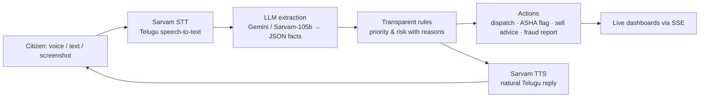

# Sahaya AI · Sahaya Setu — the AI helpline that speaks Telugu

**Sahaya Setu** (సహాయ సేతు, *the bridge of help*) connects citizens who speak Telugu with the officials who can help them — rescue teams, ASHA workers, agriculture officers and the cyber cell — through one AI voice agent.

[](https://github.com/hariswar272/sahaya-ai/actions/workflows/ci.yml)
[](LICENSE)
[](server/package.json)
[](https://sahaya.hmgenx.in)

**Live demo:** https://sahaya.hmgenx.in  ·  **Android app:** https://sahaya.hmgenx.in/download/Sahaya-AI.apk  ·  **Docs:** [Architecture](docs/ARCHITECTURE.md) · [Contributing](CONTRIBUTING.md) · [Security](SECURITY.md)

> Call Sahaya. Get real help, fast. Tell Sahaya your problem in Telugu — it understands, takes action, and connects you to the right help in seconds: rescue teams, health workers, farm advice or fraud protection.


<p align="center">
  
  
  
  <br><sub>Real screenshots from the Sahaya Android app — the AI speaking Telugu on a live call</sub>
</p>

Built for **PromptWars × Creative Community VVITU** (Hack2Skill × Google for Developers) — challenge: *AI for Better Living & Smarter Communities*.

---

## The problem

Millions of people in Andhra Pradesh and Telangana are most comfortable speaking Telugu, many use basic phones, and many cannot read English forms or apps. Yet the moments that matter most — a flood at the door, a risky pregnancy, a crop price crash, a "digital arrest" scam call — still depend on English apps, long forms or overloaded helplines.

## The solution: one voice‑AI engine, four lifelines

| Lifeline | Who it helps | What Sahaya does |
|---|---|---|
| **Disaster SOS** (`/sos`, `/console/sos`) | People stuck in floods/cyclones, district control rooms | Takes a Telugu voice or text SOS, extracts location, people, water level, vulnerable people and medical needs, ranks priority with transparent rules, auto‑dispatches the nearest rescue team for critical cases and shows everything live on a control‑room map with an AI situation report and resource forecast. |
| **Arogya Call** (`/arogya`, `/console/arogya`) | Pregnant women, BP/diabetes and TB patients, ASHA workers | AI follow‑up calls ask programme‑specific questions in Telugu, flag danger signs (bleeding, chest pain, blood in cough…) with explainable reasons, and put high‑risk patients at the top of the ASHA dashboard. Includes a one‑click call campaign. |
| **Rythu Call** (`/rythu`, `/console/rythu`) | Farmers, agriculture officers | Answers "where should I sell my tomatoes?" or "will it rain in Guntur?" by voice — live 7‑day weather (Open‑Meteo), mandi price trends with a 3‑day forecast and net‑gain sell advice, plus district alert broadcasts. |
| **Scam Shield** (`/scam`, `/console/scam`) | Elders and families, cyber‑cell awareness teams | Checks a suspicious SMS/WhatsApp message, screenshot or described call. 20+ rules plus AI analysis give a verdict, red flags and what to do, spoken in Telugu, with one‑tap 1930 / cybercrime.gov.in / family‑alert actions. |
| **Real phone calls** (`/console/phone`) | Anyone with a basic phone | The same agents can place real outbound calls through Sarvam Samvaad or Plivo (whitelisted numbers, rate‑limited). |

The website UI is in English; **the AI speaks Telugu today**, with Hindi, Tamil, Kannada, Malayalam, Marathi, Bengali, Gujarati, Punjabi, Odia and English voices on the roadmap (the engine already supports them).

## How it works



* **The AI understands, the rules decide.** The language model only extracts facts from free‑form speech; priority and risk come from simple, auditable rules, so every decision has a human‑readable reason.
* **Every fixed line is pre‑rendered** and cached on disk, so replies play instantly and the voice API is never hammered.
* **Human in the loop.** Only life‑threatening SOS cases are auto‑dispatched; everything else waits for an operator.

## Tech stack

* **Frontend:** React 18 + TypeScript + Vite, Tailwind CSS, Framer Motion, React Router, Leaflet + OpenStreetMap, Recharts — an installable **PWA** (always‑light theme, lazy‑loaded modules).
* **Backend:** Node.js 22 + Fastify 5, Server‑Sent Events for live updates, JSON stores, rate limiting and a Sarvam concurrency gate with retries.
* **AI:** Sarvam AI (saarika STT, bulbul TTS, sarvam‑105b LLM, translation) with Google Gemini support (reasoning and screenshot vision); Sarvam Samvaad / Plivo for real phone calls.
* **Android:** Flutter WebView app with microphone permission, splash animation and offline screen.
* **Hosting:** Hostinger VPS (Mumbai) + nginx + Let's Encrypt, systemd service, one‑command deploy script.

## Project structure

```
server/            Fastify API — index.mjs, lib/ (ai, voice, flow engine, i18n, store, sse, sessions)
  modules/         sos.mjs · arogya.mjs · rythu.mjs · scam.mjs · phone.mjs (auto-loaded)
  test/            69 offline unit tests (node:test)
web/               React + Vite PWA — src/components (VoiceCall, Layout, Preloader…), src/modules/<id>
android/           Flutter app wrapper (android/app)
deploy/            deploy.ps1, nginx + systemd templates
scripts/smoke.mjs  End-to-end smoke test of all modules
docs/              ARCHITECTURE.md and screenshots
```

Design principles (details in [docs/ARCHITECTURE.md](docs/ARCHITECTURE.md)):

* **Plugin modules.** Each lifeline is one server file that default-exports `{ id, register(app, ctx) }` and is auto-mounted under `/api/<id>`; it reaches the platform only through `ctx`, so modules never import each other.
* **Declarative conversations.** Voice calls are data (lines, slots, prompts, rules) run by one shared, unit-tested engine.
* **The model extracts, rules decide.** Priority and risk are computed in code with a human-readable reason.
* **Tooling.** ESLint + Prettier + EditorConfig, TypeScript strict mode, `npm test` / `npm run lint` / `npm run typecheck` at the root, and CI on every push.

## Run locally

```bash
# 1. API keys (never commit this file)
cat > .env <<'EOF'
SARVAM_API_KEY=your_sarvam_key
VOICE_SPEAKER=kavitha
# optional: GEMINI_API_KEY=...
EOF

# 2. Install and build
cd server && npm install && cd ..
cd web && npm install && npx vite build && cd ..

# 3. Start (serves the API and the built web app)
node server/index.mjs        # http://127.0.0.1:4200

# 4. Smoke test every module
node scripts/smoke.mjs http://127.0.0.1:4200
```

### Run with Docker

```bash
docker compose up --build        # builds the PWA and serves everything on http://localhost:4200
```

## Problem statement alignment: *AI for Better Living & Smarter Communities*

| Challenge area | How Sahaya addresses it |
|---|---|
| Public Safety & Emergency Response | Disaster SOS: voice triage, rule-based priority, auto-dispatch of critical cases, live control-room map, AI situation report, resource forecast |
| Healthcare & Community Wellness | Arogya Call: programme-specific AI check-ins (pregnancy, BP/diabetes, TB) with explainable danger-sign rules and PHC/108 guidance |
| Agriculture & Local Development | Rythu Call: live Open-Meteo weather, live Agmarknet mandi prices, net-gain sell advice, automatic heavy-rain alerts |
| Citizen Engagement & Public Services | Scam Shield: fraud checks with one-tap 1930 / cybercrime.gov.in reporting and family alerts |
| Accessibility & Inclusive Communities | Voice-first in Telugu, works on basic phones, no login, no reading or typing required |

### Why this is "better living" for a real community

* **One number, every emergency.** A flood victim, an expectant mother, a farmer and a scam target all get help through the *same* Telugu voice agent — no app to learn, no form to fill. The same engine can run on a basic phone through a real call.
* **Seconds, not hours.** A critical SOS is triaged and a rescue team is assigned in one call (< 10 s end-to-end in the smoke test), and the control room sees it on the map before the caller hangs up.
* **Prevention, not just response.** Danger-sign calls catch pre-eclampsia, chest pain and TB relapse before they become emergencies; sell advice uses live mandi prices so a farmer is not cheated by a middleman; a scam is explained in plain Telugu before the OTP is shared.
* **Built for officials too.** Every lifeline has a console: a live map and resource forecast for the district control room, a risk-ranked list for ASHA workers, alert broadcasts for agriculture officers, and anonymous scam trends for the cyber cell.
* **Smarter community, not surveillance.** No accounts, no tracking, scam messages never stored, health records auto-expire, and every AI decision is explained in a human-readable reason.

### Impact metrics the pilot would track

| Metric | How Sahaya measures it |
|---|---|
| Time from SOS call to team assignment | logged per incident (`createdAt` → `assignedAt`) |
| High-risk patients reached before a visit | Arogya risk flags vs ASHA follow-ups |
| Extra income per farmer from sell advice | net gain shown in every recommendation |
| Scams stopped | verdict counts and 1930 reports from Scam Shield |

### Demo walkthrough (3 minutes)

1. Open https://sahaya.hmgenx.in → **Talk to Sahaya** → say in Telugu "మేము సింగ్ నగర్ లో ఉన్నాము, నీళ్ళు మొదటి అంతస్తు వరకు వచ్చాయి, ఐదుగురు ఉన్నాము, అమ్మమ్మకి ఇన్సులిన్ కావాలి" → CRITICAL priority, boat dispatched, live pin on `/console/sos`.
2. `/scam` → paste a "digital arrest" message → SCAM verdict with red flags and one-tap 1930 report.
3. `/arogya` → ANC call in Telugu → danger sign → HIGH risk on the ASHA dashboard.
4. `/rythu` → "where should I sell 20 quintals of tomato in Guntur?" → live prices and net-gain advice.
5. Install the Android app and make the same call from a phone.

## Testing

```bash
npm test                                          # 69 offline unit tests (node:test), no API keys needed
npm run lint && npm run typecheck                 # ESLint (server + web), TypeScript strict
node scripts/smoke.mjs https://sahaya.hmgenx.in   # end-to-end: every module's API, a full voice-call flow, audio checks
```

* **Unit tests** cover the conversation engine (`lib/flow.mjs`, with the AI, voice and session layers injected as stubs), SOS triage and place matching, Arogya danger-sign rules and answer parsing, Rythu weather risk, sell advice and Agmarknet parsing, Scam Shield rules and the rule/AI merge (an AI "safe" reply can never downgrade a rule-detected scam), the tolerant JSON parser and the rate limiter.
* GitHub Actions CI (`.github/workflows/ci.yml`) runs the server tests and the web typecheck + production build on every push.
* Real-voice QA: Telugu caller audio was played into the live site through a simulated microphone and on a real Android phone, checking transcripts, AI answers, spoken replies and the final result for every module.

## Security

See [SECURITY.md](SECURITY.md). In short:
* HTTPS with HSTS, a **Content-Security-Policy** (scripts only from this origin, inline bootstrap hashed at startup) and the standard hardening headers on every response.
* `npm audit` gate in CI (no known high/critical vulnerabilities in production dependencies).
* Per-IP rate limits and input validation.
* No secrets in the repo (`.env.example` lists the variables).
* Minimal data retention: scam messages are never stored, and health records expire after 48 h.

## Accessibility

* **Voice-first in Telugu:** people who can't read or type English can still get help.
* **Typing fallback:** if the microphone is unavailable or denied, a text box is always available.
* **Keyboard and screen readers:**
  * full keyboard navigation with visible focus rings
  * semantic headings, labelled icon buttons and alt text on every image
* **Reduced motion:** `prefers-reduced-motion` turns off all animation.
* **Display:** high-contrast always-light theme, and mobile-first layouts tested at 390 px with no horizontal scroll.
* **Emergency numbers** (112, 108, 1930, 181) are one tap away on every page.

## Efficiency

* **Instant replies:** every fixed agent line is pre-rendered once and cached on disk, so replies play immediately and restarts make no repeat TTS calls.
* **Weather and prices:** responses are cached (30 min / 1 h), with last-good fallbacks.
* **Shared AI quota:** a Sarvam concurrency gate (max 3 in flight) with exponential back-off keeps one client from exhausting it.
* **Frontend:**
  * lazy-loaded modules, so the main JS chunk is about 340 kB
  * transform/opacity-only animations
  * a PWA service worker for repeat visits
* **Live updates** use a single Server-Sent Events stream, with no polling.

## Chosen vertical, approach and assumptions

**Vertical:** *AI for Better Living & Smarter Communities* — persona: a Telugu-speaking citizen in Andhra Pradesh/Telangana (a flood victim, an expectant mother, a farmer, an elderly scam target) and the local officials who serve them (control room, ASHA worker, agriculture officer, cyber cell).

**Approach and logic:**
1. Speech in → **Sarvam saarika** transcribes Telugu (or any Indian language).
2. The LLM is used *only* to extract structured facts from free speech (`extractPrompt` → JSON), validated by a `clean` step.
3. **Rules decide**: priority, risk, verdict and advice are computed in code with a human-readable reason (`triage()`, danger-sign rules, scam rules, net-gain maths).
4. Actions follow from the decision: dispatch, ASHA flag, sell advice, 1930 report — and dashboards update live over SSE.
5. **Sarvam bulbul** speaks the reply in Telugu; fixed lines are pre-rendered so replies are instant.

**Assumptions made:**
* Callers may speak informally and mix Telugu with English; the model may mis-hear, so every slot can be re-asked once and nothing critical is auto-decided from a single uncertain field.
* Rescue team positions, PHC lists and landmark coordinates are representative seed data for Vijayawada/Guntur; in a deployment they come from the district's own registers.
* Weather (Open-Meteo) and mandi prices (data.gov.in Agmarknet) are best-effort public APIs; responses are cached and the agent says so when live data is unavailable instead of guessing.
* Health answers are triage support, not diagnosis; anything high-risk is routed to a human (ASHA, PHC or 108).
* Real phone calls require a telephony provider account; the web and app voice calls work without one.
* A single Sarvam API key is shared by all modules; the concurrency gate assumes its default rate limits.

## Responsible AI

* Priority and risk come from explainable rules, never from a black box.
* Scam checks store only anonymised type/verdict counts — never the message or screenshot.
* Health answers never diagnose or prescribe; danger signs always route to the ASHA worker, PHC or 108.
* All seeded incidents, patients and mandi prices are clearly labelled **demo data**.
* Real phone calls are limited to approved numbers, rate‑limited and capped per day.

## Built with AI

The whole platform — five modules, the voice engine, the PWA, the Android app and the deployment — was built during the event with **Claude Code** (Claude Opus), coordinating parallel AI coding agents from a single lead session.
